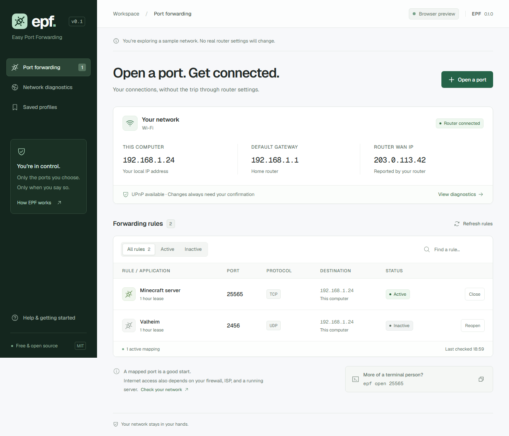
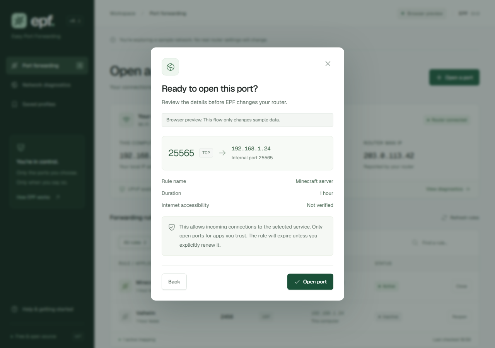

<p align="center"></p>
<h1 align="center">EPF · Easy Port Forwarding</h1>
<p align="center">Your ports, without the router menus.</p>

<p align="center">
  <a href="LICENSE"></a>
  <a href="https://github.com/infinuts/EPF/actions/workflows/ci.yml"></a>
  
  
  
</p>

Hosting a game for friends shouldn't start with a hunt through your router's settings. EPF finds your router, asks which port you need, and requests the forwarding rule for you. You review the details before anything changes.

EPF is free and open source. The desktop app and CLI use the same Rust networking engine. Installed builds don't need Node.js, Python, or Rust on your computer.



## Try it

This is the first MVP preview. The repository includes installer builds for GitHub Actions; a workflow file alone doesn't mean a release has passed testing. Check [Releases](https://github.com/infinuts/EPF/releases) for available downloads and their notes.

| Your computer          | Desktop package            | CLI archive                               |
| ---------------------- | -------------------------- | ----------------------------------------- |
| Windows x64            | `.exe` installer or `.msi` | `epf-cli-x86_64-pc-windows-msvc.zip`      |
| Linux x64              | `.AppImage` or `.deb`      | `epf-cli-x86_64-unknown-linux-gnu.tar.gz` |
| Mac with Apple Silicon | `.dmg`                     | `epf-cli-aarch64-apple-darwin.tar.gz`     |
| Mac with Intel         | `.dmg`                     | `epf-cli-x86_64-apple-darwin.tar.gz`      |

Preview installers are unsigned. macOS packages use an ad-hoc signature and are not notarized. Linux desktop builds need the system WebKitGTK 4.1 runtime; AppImage compatibility also depends on your distribution. See the release notes for the platforms actually tested.

Once installed:

1. Connect to your home network over Wi-Fi or Ethernet.
2. Click **Open a port**, enter the port from your app's instructions, and choose TCP, UDP, or both.
3. Review the destination and duration, then click **Open port**.

The default lease is one hour. Your router expires it even if EPF is closed. EPF doesn't automatically renew leases or restore old rules when you restart it. To remove a mapping earlier, click **Close** in its row and confirm.

<details>
<summary>See the confirmation step</summary>



</details>

## What works in the MVP

- Detect the default interface, local IPv4 address, and gateway.
- Discover a UPnP router and read its name, manufacturer, and model when available.
- Retry discovery directly against the default gateway when multicast discovery fails.
- Inspect individual ports on WANIPConnection v1/v2 and WANPPPConnection routers, including those with broken full-table listing.
- Open and close TCP and UDP rules, including different external and internal ports.
- Forward to this computer or a unicast IPv4 destination on the detected local subnet.
- Refresh EPF's saved rules against the router, with active, inactive, pending, unknown, and conflict states.
- Save reusable profiles without opening a port.
- Inspect the router's WAN address and look for shared or private upstream addresses.
- Optionally compare the WAN address with a public IP lookup through [ipify](https://www.ipify.org/).
- Use the desktop interface or the standalone CLI.

NAT-PMP, PCP, IPv6 firewall pinholes, automatic lease renewal, and an external port-testing service are outside this MVP.

Router support depends on firmware and settings. See the [compatibility guide](docs/router-compatibility.md) for sourced router-family notes, the new discovery and query paths, and what has actually been tested.

## A router rule isn't an internet test

When EPF says a rule was created, the router confirmed the request. Your server still needs to be running and listening on the internal port. Your computer's firewall, a second router, or your ISP can block the connection.

EPF reports internet reachability as **unverified**. This release has no external port-testing service. Connecting to your public IP from inside your home network isn't a reliable substitute for a test from another network.

The diagnostics page explains likely CGNAT or double NAT. An address in `100.64.0.0/10` suggests shared ISP addressing. A private WAN address suggests upstream NAT. A mismatch with the public IP lookup can also come from a VPN or proxy; it doesn't prove CGNAT. Your ISP can confirm your setup.

## Use the CLI

Extract the CLI archive, then run `epf` from that directory or put the executable on your `PATH`. In PowerShell, use `./epf.exe` if it isn't on `PATH`.

```sh
epf open 25565
epf open 2456 --protocol udp
epf open 27015 --protocol both --name "Game server"
epf open 8080 --internal-port 3000 --lease 900
epf close 25565
epf list --refresh
epf status
epf diagnose
epf diagnose --public-ip
```

`open` defaults to TCP. `close PORT` selects both protocols among EPF's saved rules. Use `--protocol tcp` or `--id RULE_ID` to choose more precisely. Closing a rule from another network is refused.

Opening and closing prompt you to type `yes`. Scripts must pass `--yes` explicitly; noninteractive commands without it exit before contacting the router.

```sh
epf open 25565 --protocol both --yes
epf profiles save 25565 --name "Weekend Minecraft"
epf profiles list
epf profiles delete PROFILE_ID
epf --json status
epf --config ./epf-config.json --json list
```

`epf list` reads the local journal and labels status as unknown. `--refresh` asks the router for the current state. JSON results go to stdout; JSON errors go to stderr. Exit code `0` means the command completed, `1` means a runtime error, and `2` means invalid input or missing confirmation.

## How EPF treats your network

EPF doesn't ask for router passwords. Discovery, refresh, and diagnostics don't change forwarding rules. The optional public IP check is the only application feature that contacts an external service, and it is off by default. There is no telemetry or account system.

Before opening a port, EPF queries the requested external port/protocol and refuses an occupied mapping. If the router explicitly doesn't support individual queries, EPF falls back to its original table-listing path. Before deleting one, it checks the router identity, destination, internal port, protocol, and unique `EPF:<uuid>` description against its local journal. A router that won't allow either inspection method needs manual configuration.

Operations are saved before EPF sends a change to the router. If TCP succeeds and UDP fails, EPF keeps separate records and reports partial completion. A timeout can mean the router acted without returning a reply, so refresh before retrying. EPF doesn't silently remove a successful protocol to undo a partial request.

UPnP doesn't provide transactions across apps. Another client can change a mapping between EPF's check and request, and some routers hide entries or rewrite descriptions. These limits are described in [the architecture notes](docs/architecture.md).

Configuration stays on your computer. Both interfaces use `directories::ProjectDirs` for `io / infinuts / EPF`; the resulting location follows your OS's configuration conventions. The CLI's `--config` option selects another file. A lock prevents simultaneous writers, and saves replace the JSON file atomically. Corrupt or newer configuration files produce an error and stay intact.

## Build from source

Development needs [Rust stable](https://rustup.rs/), Node.js 22 or newer, and [Tauri's platform prerequisites](https://v2.tauri.app/start/prerequisites/). Windows builds normally use MSVC Build Tools and WebView2. Linux needs WebKitGTK development packages. macOS needs Xcode Command Line Tools.

```sh
git clone https://github.com/infinuts/EPF.git
cd EPF
npm ci
npm run tauri dev
```

For the CLI alone:

```sh
cargo build --locked --release -p epf-cli
cargo run -p epf-cli -- status
```

For a browser-only UI preview:

```sh
npm run dev
# Open http://127.0.0.1:1427
```

The browser preview uses labeled sample data in a separate localStorage namespace. It cannot reach your router. Add `?scenario=offline` to explore an unsupported network. The native Tauri app always calls the real Rust engine.

Build local desktop installers with `npm run tauri build`. Outputs normally appear under `target/release/bundle/`. The [release workflow](.github/workflows/release.yml) builds desktop packages and separate CLI archives for Windows, Linux, and both Mac architectures into a draft GitHub release. Publishing remains a maintainer action.

## Checks and contributions

```sh
cargo fmt --all --check
cargo test --locked -p epf-core -p epf-cli
cargo clippy --locked -p epf-core -p epf-cli --all-targets -- -D warnings
npm run check
npm test
npx playwright install chromium
npm run test:e2e
npm run build
```

The tests use fake routers or browser sample data. They never open a port on your real network. See [CONTRIBUTING.md](CONTRIBUTING.md) for the project layout, compatibility policy, and useful router reports. The [roadmap](docs/roadmap.md) lists the next integrations.

The [verification notes](docs/verification.md) record what was checked in the initial Windows build and which hardware and platforms still need testing.

EPF was inspired by [ISPF](https://github.com/kanetjuh/ISPF). This implementation uses a new Rust engine and Tauri interface. Thanks to the maintainers of Tauri, igd-next, netdev, React, Radix, Phosphor Icons, and Geist for the pieces it is built on.

Licensed under [MIT](LICENSE).
