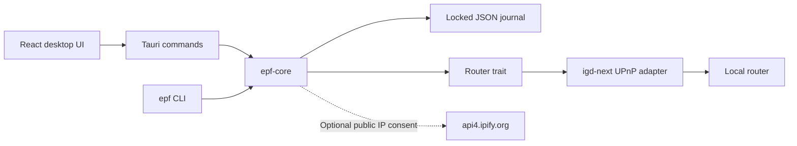

# Architecture and rule lifecycle

The desktop app and CLI depend on `epf-core`. UI code doesn't issue SSDP, SOAP, or public IP requests itself. Tauri commands run the blocking Rust work on background threads so discovery doesn't freeze the window.

## Read-only discovery

`netdev` reads the default interface and its IPv4 addresses and gateway. SSDP discovery binds to that local IPv4 address. If the responding device differs from the detected default gateway, EPF refuses to use it. `igd-next` validates the hosts of advertised device and service endpoints.

The adapter reads the device description with redirects disabled, a timeout, and a response-size limit. Router-provided names stay text in the interface. Failure to read metadata doesn't stop forwarding. Failure to discover UPnP gives a useful unsupported-network result.

The router WAN IP comes from UPnP. Only a user-approved public IP diagnostic contacts ipify. That request may follow the host's proxy settings, so a mismatch isn't conclusive evidence of CGNAT.

## Opening a rule

1. Validate the request and require explicit confirmation.
2. Restrict the destination to a unicast IPv4 address in a subnet on the detected default interface. Reject that subnet's network and broadcast addresses.
3. Enumerate visible router mappings. Refuse occupied external port/protocol keys. An enumeration error prevents mutation.
4. Generate one UUID and `EPF:<uuid>` description per protocol.
5. Save all intended operations as pending before contacting the router.
6. Send each protocol request separately, persisting each confirmed result.

TCP and UDP are separate router operations. If a later protocol fails, successful earlier mappings remain active. The failed attempt remains pending because a network error doesn't prove the router rejected it. Unattempted entries become inactive. Refresh reconciles these records with the router.

EPF requests finite leases between 60 seconds and 24 hours. A router that insists on a permanent lease returns an error. EPF doesn't silently retry with an infinite lease.

## Refreshing and closing

Refresh compares saved records with visible mappings. An exact owned match is active if enabled; an absent entry is inactive; a different entry at the same key is a conflict. An unreadable router or different network makes status unknown. Closed or superseded records are retired so reopening a port doesn't make its history claim the new mapping.

Close requires confirmation, the original router identity, and a fresh ownership check. EPF compares the external port, protocol, internal port, internal IPv4, empty remote-host restriction, and UUID description. It refuses ambiguous or changed mappings. A rule already absent on the original router can be marked inactive without sending a delete.

These checks protect against routine conflicts. UPnP has no atomic compare-and-swap operation, and some routers return incomplete lists. An unrelated LAN client can race an operation. EPF is intended for a trusted local network; its journal isn't a router authentication mechanism.

## Local storage

Schema version 1 stores rules and profiles. A rule is an operation journal record, while a profile is a reusable request that has no router effect. Desktop and CLI use the same platform-specific default file. Tests and portable CLI setups can use an explicit path.

`fs2` holds an exclusive lock for the operation. `tempfile` writes a replacement in the same directory, flushes it, then atomically replaces the config. Missing files start empty. Malformed files and unsupported schema versions fail without being reset. A crash after a router mutation can leave a pending journal entry; refreshing recovers it when ownership is still visible.

The journal is only as durable as the host filesystem and user account. Don't manually delete it while EPF rules exist: the router may keep those mappings until their leases expire, and EPF will no longer know which rules it owns.

## Desktop boundary

Only the local main window is granted the standard Tauri core capability. There are no shell, arbitrary filesystem, credential, or remote-page capabilities. Production CSP allows bundled scripts and fonts and the Tauri IPC channel. The Rust commands revalidate input and require the confirmation argument even if the interface is bypassed.

When the frontend runs outside Tauri, `api.ts` selects an explicitly labeled sample-data adapter. It uses a separate versioned localStorage key, never claims to inspect the real network, and cannot invoke the Rust network engine.

## Verification limits

Unit tests exercise the engine with an in-memory router. CLI integration tests run the executable against temporary configuration files. Playwright tests cover browser preview flows, keyboard dismissal, validation, profiles, filters, and diagnostics. These tests don't prove compatibility with a physical router or actual internet access. Native packages and representative hardware require separate release testing.
